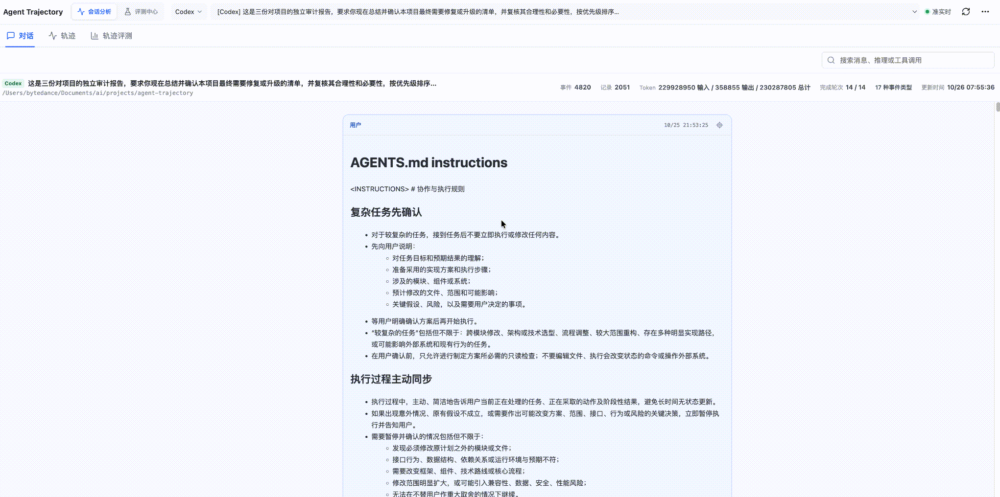

# Agent Trajectory

**简体中文** | [English](README.en.md)

Agent Trajectory 是一个本地优先、只读的多来源 Agent 轨迹查看器。它将
DeepSeek Harness、Codex、Claude Code、豆包工作、WorkBuddy、Qoder、OpenCode 和
ZCode 的本地会话转换为统一视图，帮助你回答三个问题：

- Agent 实际看到了什么，又执行了什么？
- 时间和 Token 花在了哪里，失败后是否完成恢复与验证？
- 不同 Agent、不同版本之间的轨迹质量是否真的有所改善？

项目以本地 Node.js 服务运行，通过系统浏览器展示数据，不携带 Chromium。会话读取、
确定性轨迹评测、诊断准备和人工评测工作流均在本机完成；除显式安装或移除 Hook 外，
Agent Trajectory 不修改来源会话或上游 Agent 配置。

## 产品演示

下面的动图展示了当前版本的会话分析、轨迹评测和评测中心：



## 核心功能

- **统一查看 8 种 Agent**：使用同一套会话、轮次、步骤、记录和关系模型浏览不同来源。
- **还原执行过程**：查看消息、可展示的推理片段、工具调用、错误、重试、耗时和派生关系。
- **解释上下文变化**：区分用户看到的对话、模型下一次请求的上下文和完整审计轨迹。
- **分析资源消耗**：在来源提供数据时汇总 Token、缓存读取、TTFT、模型耗时和工具耗时。
- **评测轨迹质量**：检查目标完成、要求承接、错误恢复和验证缺口，并定位支撑结论的证据。
- **建立评测闭环**：在本机完成数据冻结、双人标注、分歧裁决、baseline 对比和 badcase 回归。
- **保护本地数据**：来源只读、服务仅监听回环地址，预览、导出和评测材料递归脱敏。

## 支持的数据来源

| 来源 | 默认事实源 | 当前可投影的主要事实 |
| --- | --- | --- |
| DeepSeek Harness | `~/.dsh/sessions/**/session.vN.jsonl[.zst\|.zstd]` | v4 会话、模型上下文、Goal/Todo、嵌套工具、附件、谱系与用量 |
| Codex | `~/.codex/sessions/**/rollout-*.jsonl` | 消息、推理片段、工具调用、时间、完成状态与 Token 用量 |
| Claude Code | `~/.claude/projects/**/*.jsonl` | 消息、推理片段、工具调用、附件、用量与消息关系 |
| 豆包工作 | `~/Library/Application Support/DoubaoWork/Default/.doubaowork/agent_mode/workspace/.sessions` | 消息、工具、附件与多 Agent 派生关系；协议不提供逐事件时间和用量 |
| WorkBuddy | `~/.workbuddy/workbuddy.db` + `projects/**/*.jsonl` | 消息、推理片段、工具、附件、时间、用量、trace 与消息关系 |
| Qoder | `~/.qoder-cn/projects/**/*.jsonl` | 消息、推理片段、嵌套工具、附件、时间、用量与消息关系 |
| OpenCode | `~/.local/share/opencode/opencode.db` | 消息、推理片段、工具、附件、时间、用量与消息关系 |
| ZCode | `~/.zcode/cli/db/db.sqlite` | 消息、工具、模型与轮次用量，以及数据库存在时的 trace、谱系、policy 和 task |

“支持”不代表所有来源都拥有相同字段。适配器只投影能够从来源验证的事实；字段缺失、
协议不兼容或部分文件解析失败时，界面会显示 blocked/degraded 状态和投影覆盖率，
不会用推测值补齐。

## 快速开始

### 环境要求

- Node.js 22.12 或更高版本

### 启动

```bash
npx agent-trajectory
```

命令会启动本地服务并打开系统默认浏览器。服务使用随机的 `127.0.0.1` 端口；
关闭前台进程会同步关闭服务和 Worker。

只启动服务、不打开浏览器：

```bash
npx agent-trajectory start --no-open
```

### 检查与配置数据来源

```bash
npx agent-trajectory doctor
```

`doctor` 会显示 8 个来源的解析路径、可用状态、会话数量，以及 Hook 是否需要刷新。

如果 Agent 数据不在默认位置，可以交互式保存配置：

```bash
npx agent-trajectory setup
```

也可以直接指定路径：

```bash
npx agent-trajectory setup \
  --dsh-dir /path/to/dsh/sessions \
  --codex-home /path/to/.codex \
  --codex-sessions-dir /path/to/codex/sessions \
  --claude-projects-dir /path/to/claude/projects \
  --doubao-work-sessions-dir /path/to/doubao/.sessions \
  --workbuddy-home /path/to/.workbuddy \
  --qoder-projects-dir /path/to/qoder/projects \
  --opencode-db /path/to/opencode.db \
  --zcode-db /path/to/zcode/db.sqlite
```

来源路径的优先级为：

```text
CLI 参数 → ~/.agent-trajectory/config-v1.json → 环境变量 → 默认目录
```

配置文件支持 `${HOME}` 和 `${CONFIG_DIR}`，便于迁移到不同用户或电脑。默认情况下，
Agent Trajectory 自身的运行状态、诊断快照和评测材料保存在
`~/.agent-trajectory/`；可通过 `--data-dir` 或 `AGENT_TRAJECTORY_DATA_DIR`
选择其他目录。

## 使用说明

### 会话分析

启动后，在“会话分析”中选择来源和会话。不可用的来源不会阻断其他来源，新增或更新的
会话通常会在落盘后约 1–2 秒内出现在页面中。

页面提供四个互补视图：

- **对话**：聚焦用户与助手正文，按轮次折叠运行上下文、推理和工具。
- **模型上下文**：仅在来源提供 replacement 事实时显示模型下一次请求实际看到的内容。
- **轨迹**：展示完整审计记录、步骤关系、工具输入输出、状态、耗时和 Token。
- **轨迹评测**：以目标、执行结论、故事线、纠错链和过程指标解释任务如何推进。

搜索、时间范围、证据定位和检查器在视图间共享。检查器可查看单条记录的来源、
关联、trace/span、错误以及按需加载的脱敏原始事件。

### 本地 Agent 诊断

“轨迹评测”中的本地分析始终自动运行，不调用模型。需要进一步诊断时，可以点击
“本地 Agent 诊断”：

1. 服务在本机创建私有、脱敏的冻结快照；
2. 页面生成并复制一个轻量诊断 Prompt；
3. 你在可访问本机文件的新 Agent 会话中粘贴执行；
4. 内置 `trajectory-diagnosis` Skill 按需读取证据并生成报告。

该入口不会自动创建 Agent 会话、发送消息或读取 Agent 凭证。报告只总结可观察到的判断、
行动和反馈，不展示或编造隐藏思维链。

### 评测中心

“评测中心”用于跨会话、跨版本的质量评估。浏览器界面支持准备私有数据集、Reviewer
双标、分歧裁决、运行指定 split、选择 baseline，以及查看 badcase 汇总。badcase 的
决策和复测通过 CLI casebook 命令完成。所有数据都保存在当前本机数据目录。

也可以从 CLI 运行内置的脱敏合成契约数据集：

```bash
npx agent-trajectory evaluate
```

报告默认写入 `~/.agent-trajectory/evaluations/`，也可以指定目录或 baseline：

```bash
npx agent-trajectory evaluate --output-dir ./evaluation-reports
npx agent-trajectory evaluate --baseline ./evaluation-reports/baseline.json
```

需要用本机真实轨迹校准时，使用三阶段流程：

```bash
# 1. 冻结并脱敏候选
npx agent-trajectory calibrate prepare \
  --dataset ~/.agent-trajectory/calibration/real-v1 \
  --count 30

# 2. 两位 Reviewer 完成模板后，生成一致性报告和裁决模板
npx agent-trajectory calibrate agreement \
  --dataset ~/.agent-trajectory/calibration/real-v1 \
  --reviewer-a ~/.agent-trajectory/calibration/real-v1/reviewer-a.json \
  --reviewer-b ~/.agent-trajectory/calibration/real-v1/reviewer-b.json

# 3. 独立裁决完成后运行指定 split
npx agent-trajectory evaluate \
  --dataset ~/.agent-trajectory/calibration/real-v1 \
  --adjudication ~/.agent-trajectory/calibration/real-v1/adjudication.json \
  --split regression
```

真实候选经过冻结、脱敏、假名化和隐私审计，但仍可能包含完成评测所必需的业务文本，
只应保留在本机私有目录，不要提交或上传。`independent` split 仅用于最终验收，避免
根据独立测试结果反向调整规则。

### 新会话自动联动

自动联动只支持 **DSH、Codex 和 ZCode**。安装 Hook 后，新建这三种来源的顶层会话时，
Agent Trajectory 会启动或复用本地实例，并切换到对应会话：

```bash
npx agent-trajectory install-hooks
```

安装后需要重启 DSH 和 ZCode；Codex 需要通过 `/hooks` 检查并信任新增 Hook。
Node 路径、系统、数据目录或版本变化后，重新运行 `install-hooks` 即可刷新。

移除本项目安装的联动项：

```bash
npx agent-trajectory uninstall-hooks
```

其余五种来源仍可正常发现和查看，只是不提供新会话自动激活。Hook 安装与卸载是唯一会
修改上游 Agent 配置的功能。修改使用项目标记和文件事务，任一步失败都会恢复原内容；
Hook 失败也不会阻断 Agent 会话。

## 常用命令

| 命令 | 用途 |
| --- | --- |
| `agent-trajectory` | 启动或复用实例并打开页面 |
| `agent-trajectory start --no-open` | 只启动本地服务 |
| `agent-trajectory doctor` | 检查 8 个来源和 Hook 状态 |
| `agent-trajectory setup` | 交互式保存来源路径 |
| `agent-trajectory install-hooks` | 为 DSH、Codex、ZCode 安装新会话联动 |
| `agent-trajectory uninstall-hooks` | 移除本项目安装的联动项 |
| `agent-trajectory evaluate` | 运行合成或已裁决数据集并生成报告 |
| `agent-trajectory calibrate prepare ...` | 冻结真实轨迹校准候选 |
| `agent-trajectory calibrate agreement ...` | 计算双标一致性并生成裁决模板 |
| `agent-trajectory casebook list` | 查看本地 badcase casebook |
| `agent-trajectory casebook decide ...` | 记录 badcase 决策 |
| `agent-trajectory casebook retest ...` | 将评测运行记录为 badcase 复测 |

所有命令都可使用 `--data-dir <路径>` 指定 Agent Trajectory 的本地数据目录。评测命令的
完整参数约束可直接通过命令报错提示确认；外部数据集必须与 adjudication 一起提供，并显式
选择 `calibration`、`regression` 或 `independent` split。

### 离线或内网分发

```bash
npm run pack:tgz
npx --yes ./agent-trajectory-0.1.0.tgz
```

发行物只包含 Node.js 服务、React 静态页面、Worker 和内置 Zstandard 解码器。

## 导出

- **投影导出**：导出浏览器当前加载的统一会话视图，适合查看和二次处理。
- **审计导出**：导出完整、已脱敏的投影和来源事件，包括未形成展示记录的事件。

详情接口默认只返回脱敏预览；超长输入输出会明确标记截断，原始事件按需加载。

## 工作原理

```text
DSH / Codex / Claude / 豆包 / Qoder 文件 --------> 来源适配器 ----+
WorkBuddy SQLite + JSONL -----------------------> 只读 Worker ----+--> 投影 Worker
OpenCode / ZCode SQLite ------------------------> 只读 Worker ----+        |
                                                                         v
                                                                SourceRegistry
                                                                         |
                                                               本地 API + SSE
                                                                         |
                                                               React Web 界面
```

1. **来源适配层**只扫描配置根目录中的白名单文件；SQLite 来源通过只读 Worker 查询，
   避免数据库工作阻塞服务主线程。
2. **统一投影层**将来源事件转换为共同的会话、轮次、步骤、记录、用量和关系模型，同时
   保留来源 ID、证据 ID 和保真度。
3. **服务层**通过仅绑定 `127.0.0.1` 的 Node.js API 提供来源探测、会话详情、按需原始
   事件、导出、评测工作流和 SSE 更新；缓存与 Worker 均有容量边界。
4. **展示层**在系统浏览器中提供会话分析与评测中心，不需要内嵌浏览器运行时。

8 个来源的发现、解析和投影逻辑彼此隔离。单个来源不可用或单个文件损坏时，其他来源仍可
继续工作；无法验证的结构和关联会安全失败，而不是被包装成统一事实。

## 安全与隐私

- 服务只绑定 `127.0.0.1`，并校验 Host、端口和远端地址。
- 客户端只能提交来源和 opaque session ID，不能提交任意本地路径。
- 文件来源只扫描预设目录中的白名单文件；WorkBuddy、OpenCode 和 ZCode 数据库以只读
  模式打开。
- 不读取凭证、证书、Cookie、浏览器存储或模型请求头。
- 工具输入输出、原始事件和导出内容中的敏感键会递归脱敏。
- 普通浏览、投影、诊断准备和评测不会访问外部网络、修改来源会话或执行 Agent 工具。
- 诊断快照、校准数据、评测报告和 badcase 均保存在本机数据目录。
- Hook 只有在用户显式运行安装或卸载命令后才会修改 DSH、Codex、ZCode 配置，并使用
  文件事务保证失败回滚。

完整的安全边界和漏洞报告方式见[安全策略](SECURITY.zh-CN.md)。

## 本地开发

```bash
npm ci
npm run dev
```

开发服务默认地址为 <http://127.0.0.1:4317>，会监听前端和服务端源码变化。

生产构建与启动：

```bash
npm run build
npm start
```

常用环境变量：

```bash
PORT=4318 npm run dev
DSH_SESSIONS_DIR=/path/to/sessions npm run dev
CODEX_HOME=/path/to/.codex npm run dev
CODEX_SESSIONS_DIR=/path/to/codex/sessions npm run dev
CLAUDE_PROJECTS_DIR=/path/to/claude/projects npm run dev
DOUBAO_WORK_SESSIONS_DIR=/path/to/doubao/.sessions npm run dev
WORKBUDDY_HOME=/path/to/.workbuddy npm run dev
QODER_PROJECTS_DIR=/path/to/qoder/projects npm run dev
OPENCODE_DB=/path/to/opencode.db npm run dev
ZCODE_DB=/path/to/zcode/db.sqlite npm run dev
```

默认使用内置 JavaScript Zstandard 解码器；只有显式设置 `ZSTD_BIN` 时才使用外部
`zstd` 可执行文件。

## 验证

```bash
npm test
npm run build
npm audit --registry=https://registry.npmjs.org
```

对已有真实来源验证脚本覆盖的来源，可以运行只读冒烟验证：

```bash
npm run verify:real-sources
```

验证摘要默认只写到标准输出，不包含会话正文、原始 session ID、主目录路径或凭据。
如使用 `--output` 保存摘要，该文件仍由本机真实会话派生，不应提交到公开仓库。

## 参与贡献

提交修改前请阅读[贡献指南](CONTRIBUTING.zh-CN.md)。请只使用合成 fixture，
不要提交真实 Agent 会话、本地路径、凭证、私有 Prompt 或未脱敏导出。

## 许可证

本项目采用 [MIT License 英文原文](LICENSE)。[中文翻译](LICENSE.zh-CN.md)仅供参考。
